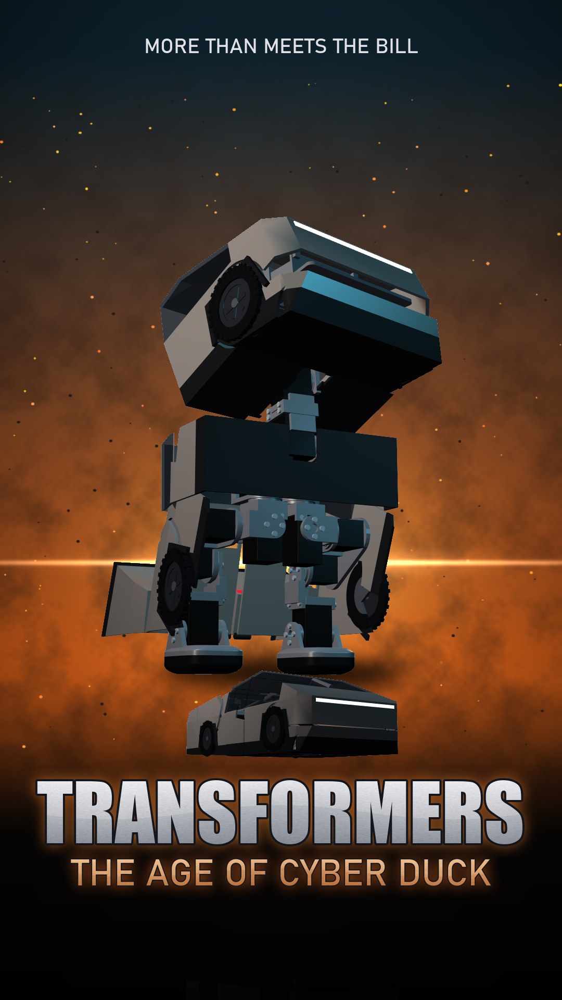
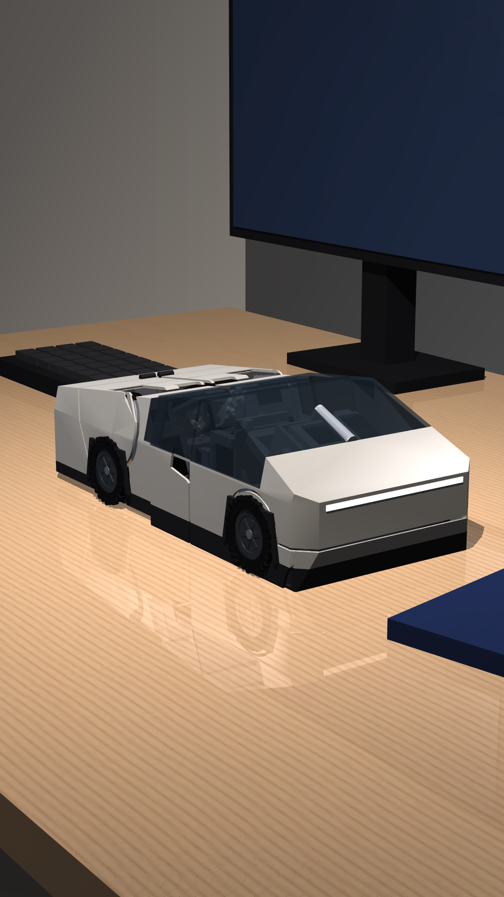

# Cyber Duck

A small all-Dynamixel biped duck that folds into a stainless wedge truck, and back. A design study, worked out
offline in simulation: the shapes and the moves. Nothing has been printed or built yet, and the transformation and
the walk are kinematic, not physics.

**Video:** [`docs/videos/cyber_duck/cyber_duck_final.mp4`](docs/videos/cyber_duck/cyber_duck_final.mp4) (portrait,
18 s): the truck on a desk gets up on its bill, chats, and walks off as its covers come away.

**How it works, what's proven and what isn't:** [`docs/CYBER_DUCK.md`](docs/CYBER_DUCK.md).

## Where it comes from

A snapshot of [duck-droids](https://github.com/meetsitaram/duck-droids) (its `transformer` branch, commit
`0909dd5`, on main at `23bb301`), slimmed to the all-Dynamixel duck Cyber Duck is built on: its spec, CAD, prints and
docs, every tool, and the Cyber Duck tools and media. The other ducks (hybrid, HD-1910, Feetech, big, nano), the long
build videos and the history are in duck-droids; its original README is
[`docs/DUCK_DROIDS_README.md`](docs/DUCK_DROIDS_README.md) (some of its links point at those).

Run the Cyber Duck tools with `MILLI_RECIPE=dynamixel` (see `docs/CYBER_DUCK.md`); they run under a 6 GB memory cap.

Licence: Apache-2.0 ([`LICENSE`](LICENSE)); see [`THIRD_PARTY_NOTICES.md`](THIRD_PARTY_NOTICES.md).
"Transformers" is Hasbro's trademark and "Cybertruck" Tesla's; this is a fan design study, not affiliated with either.
