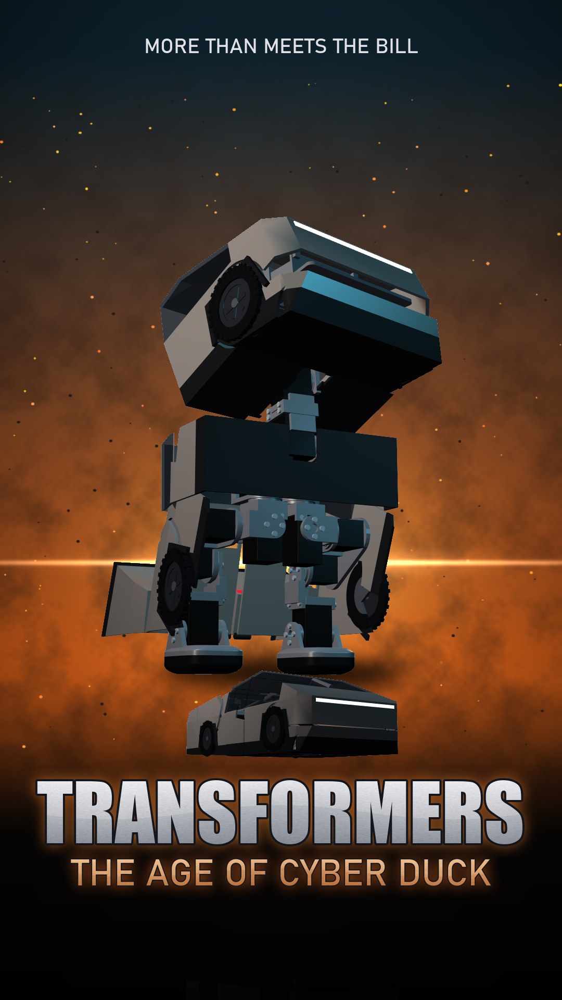

# Cyber Duck

The all-Dynamixel duck that folds into a wedge truck (Cybertruck-like), and back. A design study: the shapes and the
moves, worked out offline in simulation. Nothing here has been printed or built, and the transformation and the walk
are kinematic, not physics.

Video: [`videos/cyber_duck/cyber_duck_final.mp4`](videos/cyber_duck/cyber_duck_final.mp4): the poster, then the truck
on a desk getting up on its bill, chatting, and walking off with its covers coming away.

## How it folds

- **Truck mode:** the duck lies face down. The head pitches back, so its crown is the windshield and its face the
  underside of the nose; the body is the cab under the roof's peak; the legs, stretched back and tipped to the floor,
  are the bed; the feet fold flat under the tail. 32.8 x 15.2 x 10.6 cm, 3.1 : 1 long to high like the real truck,
  23 deg windshield, 8 deg bed.
- **The bill:** the truck's lower nose and front wheel are the duck's lower jaw, pivoting on the wheel's hub (the beak
  servo).
- **The tail flaps:** a panel per side, hinged on the shin, tucked like wings for walking, spread to close the tail.
  Two extra small servos.
- **Joints and seams:** the knee seam is an arc round the knee axis (the shin turns in place against the thigh); the
  thigh panels are nested 2.8 mm inside the body's skin and slide under it; the legs are open at the front and between
  them, so they walk freely. In every walking pose checked nothing but the feet comes within 8 mm of the floor.
- **Getting up:** from the truck the flaps tuck, the bill goes down on the floor, the chest rises on the bill and the
  legs, the feet come in under the body, then it stands. The keyframes are solved for static balance with the mass
  model plus the shells (slow moves only; no torque or dynamics check yet).

## Not proven yet

- The shells add about 378 g to a 962 g duck, mostly in the head: thinner or partial shells before trusting the
  XL330s to walk with it.
- The deep squat in the get-up has the hips and knees at their limits: torques not checked.
- The head's inner skeleton and the electronics poke through the shells in places: they are to be laid out again.
- Given up as Cyber Duck: the deep floor-pick squat.

## Tools

All run with `MILLI_RECIPE=dynamixel`, each under a 6 GB memory cap (`tools/memcap.py`):

| tool | what it does |
|---|---|
| `tools/cyber_duck.py` | builds the shells in the truck pose, carves them for clearance in every pose, checks collisions, renders the sheet |
| `tools/cyber_duck_run.sh` | runs it in small batches, two pieces per process, so memory goes back to the PC |
| `tools/cyber_duck_getup_solve.py`, `cyber_duck_getup_frames.py` | solve the get-up keyframes for static balance |
| `tools/cyber_duck_getup_check.py` | what touches the floor and the balance margin at every step of getting up |
| `tools/cyber_duck_render.py` | the desk scene: stills and the portrait clip |
| `tools/cyber_duck_poster.py`, `cyber_duck_final.py` | the poster, and the poster plus the clip |
| `tools/transformer_pose.py`, `transformer_sweep.py` | the first study (sitting with the head folded over the legs: a 1.8 : 1 box, dropped) |

"Transformers" is Hasbro's trademark and "Cybertruck" Tesla's; this is a fan design study, not affiliated with either.
